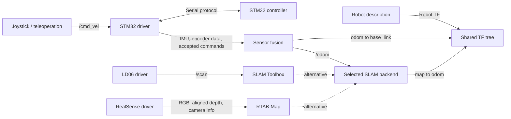

# Open-PiRobot architecture

## Purpose and current baseline

Open-PiRobot is a modular ROS 2 software stack for a Raspberry Pi 5 mobile
robot. It connects the STM32 controller and sensors to state estimation,
mapping, teleoperation, and voice output. The existing implementation is the
foundation of the project; development extends it incrementally.

The migration branch targets ROS 2 Jazzy on Ubuntu Noble 24.04. See the
[migration report](MIGRATION_HUMBLE_TO_JAZZY.md) for development-PC validation
and the outstanding Raspberry Pi hardware acceptance checks.
The intended deployment platform is ARM64, with AMD64 development builds where
supported. ROS runs inside containers rather than requiring an installation
on the host.

## Repository and deployment boundaries

The root repository integrates the system. `Open-PiRobot.sh` is a thin wrapper
around the modular Python manager in `scripts/robot_manager/`. The manager reads
the ordered runtime registry from `config/robot.yaml` and coordinates
module-owned Docker Compose files. Each capability keeps its own dependencies
and image so changes can be built and tested independently.

| Location | Responsibility |
| --- | --- |
| `src/open_pi_bringup/` | Launch the robot description and robot state publisher |
| `src/robot_descriptor/` | Xacro, URDF, robot geometry, and description assets |
| `docker/`, `compose.yaml` | Main robot-description image and service |
| `interfaces/` | Shared custom ROS messages and services |
| `drivers/Ros2_stm32_driver/` | Serial bridge to STM32, control, IMU, encoder and joint data |
| `drivers/Ros2_lidar_driver/` | LD06 LiDAR and laser scan publication |
| `drivers/Ros2_realsense_driver/` | RealSense RGB, aligned depth, and camera information |
| `modules/Ros2_sensor_fusion/` | EKF state estimation and fused odometry |
| `modules/Ros2_slam_module/` | Selectable SLAM Toolbox or RTAB-Map mapping |
| `modules/Ros2_tts_voice/` | Piper text-to-speech and audio output |
| `modules/teleoperation/` | Joystick input and velocity commands |

The drivers and modules are Git submodules. In this checkout `interfaces/`
is tracked directly by the root repository, despite a stale `.gitmodules` entry.
It supplies the same source definitions to STM32 and teleoperation builds.
The drivers and modules have separate Git histories; the root records their commit IDs.
Changing files in a submodule and updating its parent gitlink are distinct steps.

## Data flow

The SLAM backend box represents the selected alternative, not an additional
node. Voice is an independent capability alongside this sensing/control path.

The current teleoperation publisher and STM32 subscriber use
`geometry_msgs/msg/TwistStamped` on `/cmd_vel`. The driver publishes accepted
commands as `geometry_msgs/msg/Twist` on `/cmd_vel/accepted`; the EKF configuration
selects that topic alongside IMU and encoder inputs. Message types are part of
the integration contract, even when topic names look similar.

Sensor fusion publishes `/odom`. Encoder-only `/odom/solo` is diagnostic data
and does not replace fused odometry or publish its TF edge. Check each module's
configuration for actual topic names, remappings, and enabled inputs.

## ROS communication and transforms

Containers use host networking and Cyclone DDS through
`RMW_IMPLEMENTATION=rmw_cyclonedds_cpp`. Communicating processes share a
`ROS_DOMAIN_ID`. Topic types, QoS, timestamps, and frame names must agree across
container boundaries; a running container alone does not prove integration.

The main TF chain is `map -> odom -> base_link`, with robot links and sensors
beneath it:

- The selected SLAM backend owns `map -> odom`.
- Sensor fusion owns `odom -> base_link`.
- Robot state publisher uses the robot description and joint states to publish
  robot transforms. Sensor drivers may publish their own internal sensor frames.

Each TF edge must have one owner. SLAM Toolbox currently uses `base_footprint`
as its robot frame, while RTAB-Map uses `base_link`; the description must connect
these frames consistently.

## Mapping and lifecycle

Only one SLAM backend runs at a time:

| Backend | Inputs | Manager selector |
| --- | --- | --- |
| SLAM Toolbox | LiDAR `/scan`, odometry TF | `--slam_toolbox` |
| RTAB-Map | RGB, aligned depth, camera info, `/odom` | `--slam__rtab` (`--slam_rtab` alias) |

The central manager supports `stm32`, `lidar`, `realsense`, `fusion`, `slam`,
`voice`, `robot`, and `teleoperation`. Teleoperation is registered last and is
excluded from the default group, so it must be selected explicitly.
The manager checks the STM32 and the sensors required by the chosen mapping
backend before relevant startup operations. Image-only builds do not require
connected hardware.

Use `./Open-PiRobot.sh build <target>` to build selected images. `create` builds
and starts services; `start` reuses existing containers, and `restart` recreates
them using the current image/configuration. Full command details are in the
[manager reference](README.md).

The runtime registry is independent from Git submodule metadata. Registering a
component makes an existing Compose service manageable; it does not clone,
initialize, pull, or update the directory that contains that service.

Configuration belongs to its module. Mapping data is persisted through the
SLAM module's data mount. The current RTAB-Map configuration uses
`reset_mapping`, which deletes `/data/rtabmap.db` on startup; select a preserving
mode before relying on an existing map.

## Development and further reading

Make changes within the existing module boundaries and validate affected
contracts. Build and test affected components and their actual dependents;
whole-stack validation is appropriate when the change crosses those boundaries.
Hardware checks, successful builds, and runtime validation are separate evidence.

- [Development rules](rule.md)
- [Project overview](../README.md)
- [Container architecture decision](ADR-001-containerized-modules.md)
- [SLAM selection decision](ADR-002-selectable-slam-backends.md)
- [Agent instructions and migration skills](../AGENTS.md)
